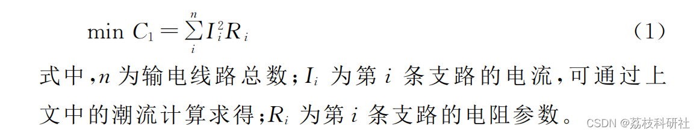
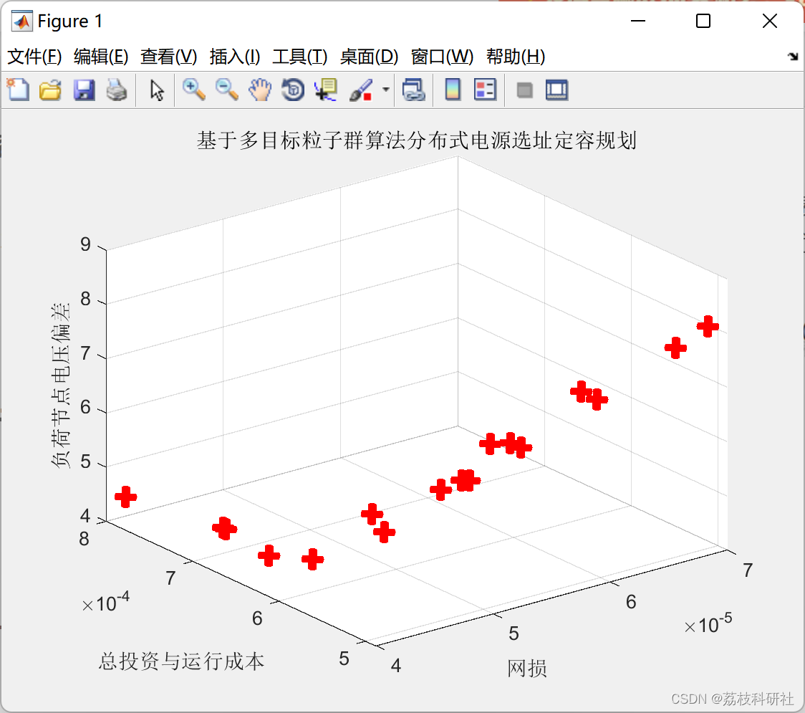

# [Location and Capacity Planning for Distributed Energy] Research on the Location and Capacity Planning of Distributed Power Sources Based on Multi-Objective Particle Swarm Algorithm (Matlab Code Implementation)

🏆 Bloggers' Advantage: 🌞🌞🌞 The content of the blog strives to be rigorous in thought and clear in logic, for the convenience of readers.
⛳️ Mantra: The journey of a hundred miles is half done in the last ninety.
📋📋📋This article is organized as follows: 🎁🎁🎁Table of Contents💥1 Overview
Editor 💥1 Overview of References:
Editor
This article adopts a different approach, based on the research of distributed power source location and capacity planning with multi-objective particle swarm algorithm.
The integration of distributed generation technologies from renewable energy with the large-scale power grid is widely recognized as an energy-saving, emission-reducing, and environmentally friendly method for safe and reliable power system operation. It represents the direction for power development. Distributed Generation (DG) refers to small modular power units that are distributed in a user's vicinity within a certain geographical area, compatible with the environment, and have a power generation capacity ranging from several kilowatts to several tens of megawatts.
Distributed generation (DG) systems are currently mostly connected to the distribution network. After being connected to the grid, DGs can influence the flow distribution of the distribution network and thus optimize it, alleviating the pressure on the distribution network's transmission and distribution voltage levels. However, due to the significant randomness in DGs' integration and disconnection, as well as their output power stability being easily affected by environmental factors, improperly connected DGs can have numerous negative impacts on the power grid, such as affecting the stability of the distribution network and its voltage quality, generating harmonics, etc. The magnitude of these impacts is greatly related to the capacity and location of the DGs, making the selection and sizing of DGs a key issue during the planning stage.
Due to the single-minded optimization objectives of planning, traditional planning methods struggle to effectively address this issue. In recent years, multi-objective optimization that takes into account factors such as voltage, current quality, and environmental conditions has developed rapidly. However, the lack of standardization in these variables significantly increases the complexity of the problem, presenting new challenges for multi-objective optimization. This paper, building on the research of the standard particle swarm optimization algorithm, addresses the location and capacity selection issues in distribution networks with Direct Energy Resources (DER). A mathematical model is established, which includes objective functions such as power loss, voltage quality, and total DER capacity connected to the grid. The study employs a distributed multi-objective particle swarm algorithm to solve the problem, using Matlab for implementation.
1.1 Power loss: The power loss in the process of transmitting electricity from the generation end to the load end is unavoidable, but it can be minimized by reducing active power loss and effectively configuring Distributed Generation (DG) in the distribution network. This can effectively reduce active power loss, improve the utilization rate of electricity generation, and save energy. The objective function for minimizing active power loss is optimally expressed as follows:
The quality of pressure is affected by the voltage stability of the distribution system. The voltage quality is described by the variance of the voltage based on the expected voltage. The optimal mathematical expression of the objective function based on voltage quality is:
Editor
1.3 The total capacity of DG must not only consider the economic effects of improving the power grid, but also take into account the costs associated with the installation, operation, and maintenance of DG. This article does not involve economic models, only considers the total capacity of DG connected to the distribution network. The optimal mathematical expression of the objective function based on the total capacity of DG is:
Editor
📚2 Running Results Editing
🌈3 Matlab code implementation:
% Jacobian matrix
J=[jpt jpv; jqt jqv];  
X = (inv(J))*M;% deviation
%% Phase deviation
dTh = X(1:nbus-1);  
%% Voltage deviation
dV = X(nbus:end);  
[e1, d1, n1] = eig(JR); % Calculate the eigenvalues and eigenvectors of matrix A using the function eig(A)[V, D, W] = eig(A), where [V, D, W] = eig(A) returns a full matrix W such that W'A = DW'.
%diag(A), if A is a matrix, the function diag() generates a diagonal matrix extracted from the matrix; if a is a vector, the function diag() generates a matrix with a diagonal of the vector a.
%% Target 2 Voltage Stability
f2val = max(1./diag((d1)))*max(abs(dQ));% Target 2, Stability
del(2:nbus) = dTh + del(2:nbus);  
k = 1;  
for i = 2:nbus  
if type(i) == 3  
V(i) = dV(k) + V(i);  
k = k+1;  
end  
end  
%% Target 2 and Target 3
tval=sum(1./diag((d1)));  
po_val=flow_cal(nbus,V,del,BMva);  
f1val=sum(po_val); % Various branch network losses
f3val=sum(datain(5:8)); %DG capacity and
fout=[f1val; f2val; f3val];  
for i = 1 : N  
% Number of individuals that dominate this individual  
individual(i).n = 0;  
% Individuals which this individual dominate  
individual(i).p = [];  
for j = 1 : N  
dom_less = 0;  
dom_equal = 0;  
dom_more = 0;  
for k = 1 : M  
if (x(i,V + k) < x(j,V + k))  
dom_less = dom_less + 1;  
elseif (x(i,V + k) == x(j,V + k))  
dom_equal = dom_equal + 1;  
else  
dom_more = dom_more + 1;  
end  
end  
if dom_less == 0 && dom_equal ~= M
individual(i).n = individual(i).n + 1;  
elseif dom_more == 0 && dom_equal ~= M % < =
individual(i).p = [individual(i).p j];  
end  
end  
if individual(i).n == 0  
x(i,M + V + 1) = 1;  
F(front).f = [F(front).f i];  
end  
end  
% Find the subsequent fronts  
while ~isempty(F(front).f)  
Q = [];  
for i = 1 : length(F(front).f)  
if ~isempty(individual(F(front).f(i)).p)  
for j = 1 : length(individual(F(front).f(i)).p)  
individual(individual(F(front).f(i)).p(j)).n = ...  
individual(individual(F(front).f(i)).p(j)).n - 1;  
if individual(individual(F(front).f(i)).p(j)).n == 0  
x(individual(F(front).f(i)).p(j),M + V + 1) = ...  
front + 1;  
Q = [Q individual(F(front).f(i)).p(j)];  
end  
end  
end  
end  
front = front + 1;  
F(front).f = Q;  
end  
[temp,index_of_fronts] = sort(x(:,M + V + 1));  
for i = 1 : length(index_of_fronts)  
sorted_based_on_front(i,:) = x(index_of_fronts(i),:);  
end  
current_index = 0;  
%% Crowding distance  
%The crowing distance is calculated as below  
% ?For each front Fi, n is the number of individuals.  
% ?initialize the distance to be zero for all the individuals i.e. Fi(dj ) = 0,  
%  where j corresponds to the jth individual in front Fi.  
% ?for each objective function m  
%   * Sort the individuals in front Fi based on objective m i.e. I =  
%    sort(Fi,m).  
%   * Assign infinite distance to boundary values for each individual  
%    in Fi i.e. I(d1) = ? and I(dn) = ?  
%   * for k = 2 to (n ? 1)  
%     ?I(dk) = I(dk) + (I(k + 1).m ? I(k ? 1).m)/fmax(m) - fmin(m)  
%     ?I(k).m is the value of the mth objective function of the kth  
%      individual in I  
% Find the crowding distance for each individual in each front  
for front = 1 : (length(F) - 1)  
%  objective = [];  
distance = 0;  
y = [];  
previous_index = current_index + 1;  
for i = 1 : length(F(front).f)  
y(i,:) = sorted_based_on_front(current_index + i,:);  
end  
current_index = current_index + i;  
% Sort each individual based on the objective  
sorted_based_on_objective = [];  
for i = 1 : M  
[sorted_based_on_objective, index_of_objectives] = ...  
sort(y(:,V + i));  
sorted_based_on_objective = [];  
for j = 1 : length(index_of_objectives)  
sorted_based_on_objective(j,:) = y(index_of_objectives(j),:);  
end  
f_max = ...  
sorted_based_on_objective(length(index_of_objectives), V + i);  
f_min = sorted_based_on_objective(1, V + i);  
y(index_of_objectives(length(index_of_objectives)),M + V + 1 + i)...  
= Inf;  
y(index_of_objectives(1),M + V + 1 + i) = Inf;  
for j = 2 : length(index_of_objectives) - 1  
next_obj = sorted_based_on_objective(j + 1,V + i);  
previous_obj = sorted_based_on_objective(j - 1,V + i);  
if (f_max - f_min == 0)  
y(index_of_objectives(j),M + V + 1 + i) = Inf;  
else  
y(index_of_objectives(j),M + V + 1 + i) = ...  
(next_obj - previous_obj)/(f_max - f_min);  
end  
end  
end  
distance = [];  
distance(:,1) = zeros(length(F(front).f),1);  
for i = 1 : M  
distance(:,1) = distance(:,1) + y(:,M + V + 1 + i);  
end  
y(:,M + V + 2) = distance;  
y = y(:,1 : M + V + 2);  
z(previous_index:current_index, :) = y;  
end  
f = z();  
🎉4 References  
[2] Feng Yuanyuan. Research on the Site Selection and Capacity Determination of Distributed Power Generation Based on Multi-Objective Planning [D]. North China Electric Power University, 2015.  
[3] Yang Zhijun. Site Selection and Capacity Determination of Distributed Power Sources Based on Particle Swarm Optimization [D]. Taiyuan University of Science and Technology, 2019.DOI:10.27721/d.cnki.gyzjc.2019.000065.

## Images

<!-- PAYMENT_BLOCK -->

## Get this dataset

- Payment link (Stripe): [Buy now](https://buy.stripe.com/3cs8yP7sY87d0vu9AB)
- Payment QR code: 

<!-- /PAYMENT_BLOCK -->
